# 📕 Pokédex — Edição Kanto em Pixel Art

Atividade 03 de **Desenvolvimento e Integração de Aplicações Web**: uma Pokédex interativa feita com **React + Vite**, com visual de videogame retrô em pixel art. Os dados vêm do arquivo `pokedex-data.json` fornecido na atividade.

**Autora:** Lorrainny Camille Aparecida Gonçalves (atividade individual)

## 🖼️ Prints

| Tela inicial | Menu |
| --- | --- |
| 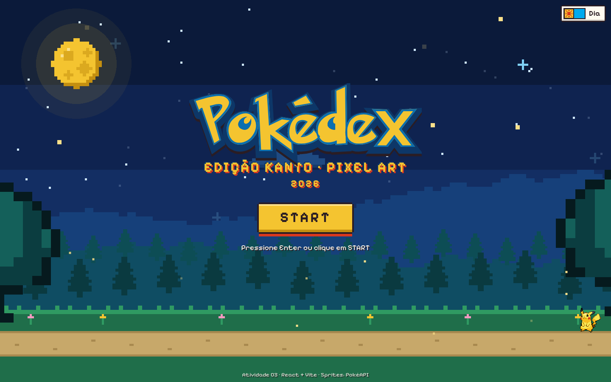 | 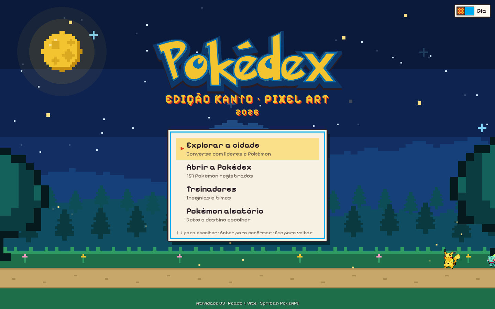 |

| Cidade de dia | Cidade de noite |
| --- | --- |
| 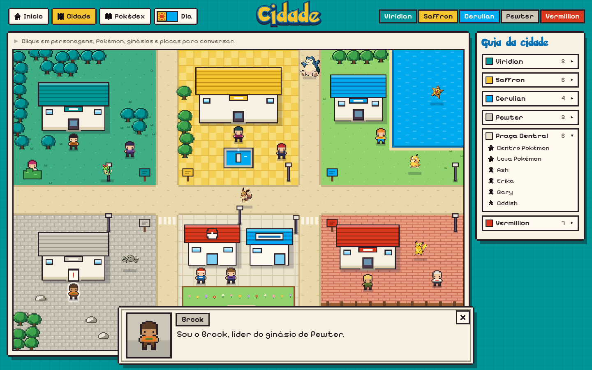 | 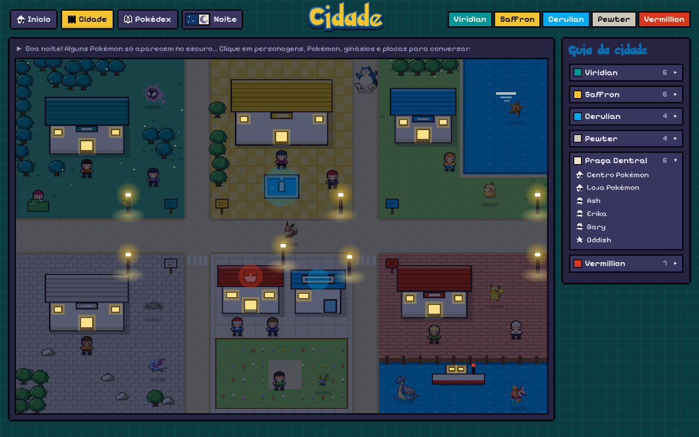 |

| Pokédex em grade | Pokédex em lista |
| --- | --- |
| 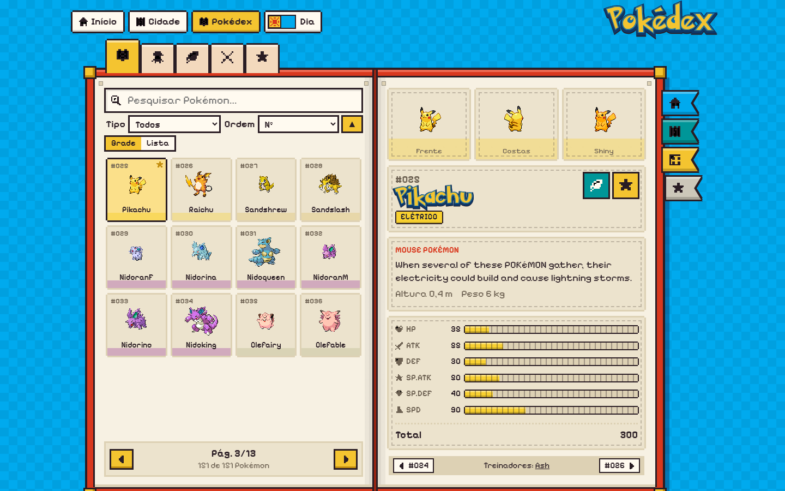 | 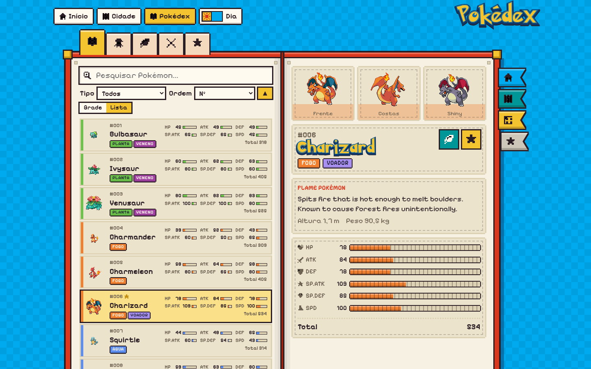 |

| Pokédex no modo noturno | Treinadores |
| --- | --- |
| 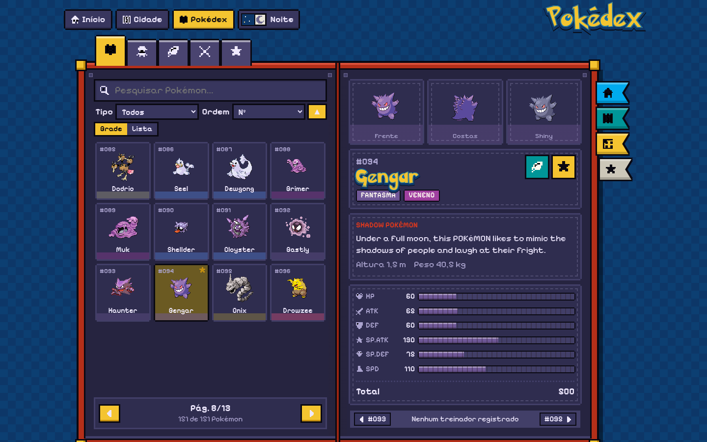 | 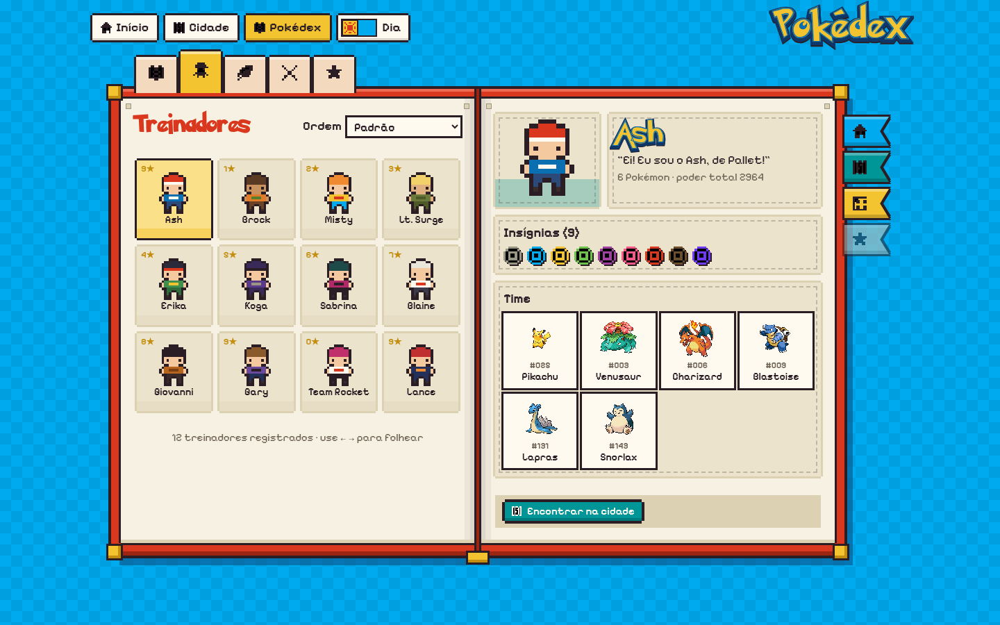 |

| Habitat | Habitat à noite |
| --- | --- |
| 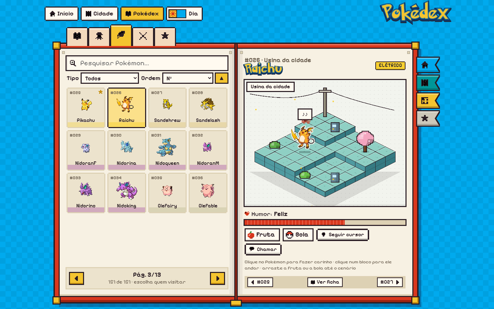 | 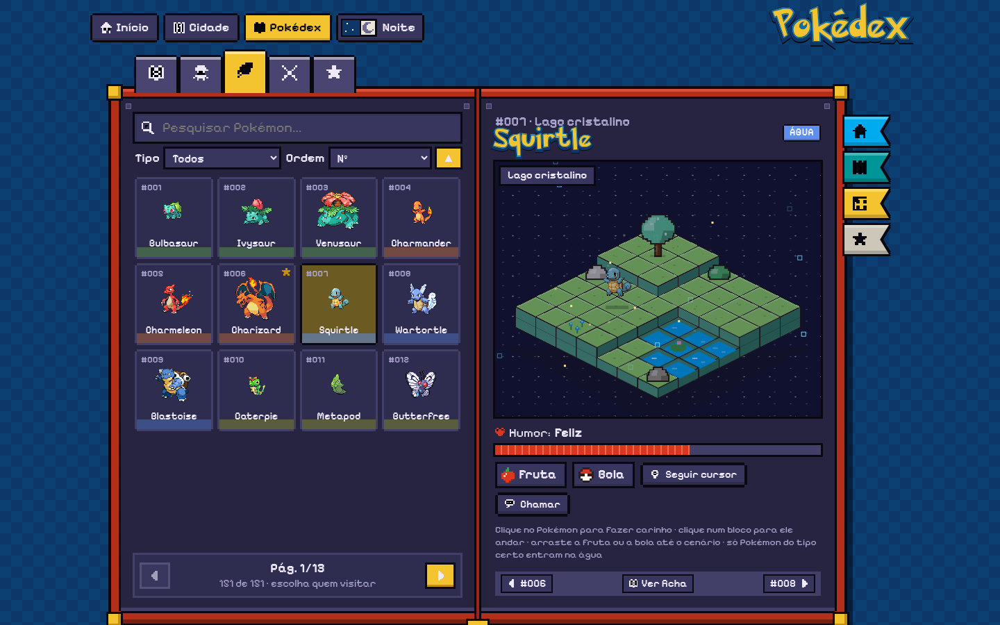 |

| Comparação | Página de erro 404 |
| --- | --- |
| 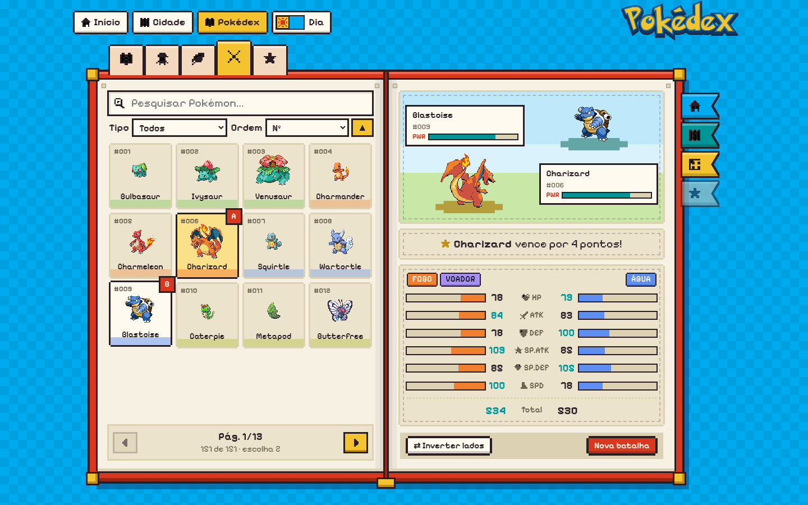 | 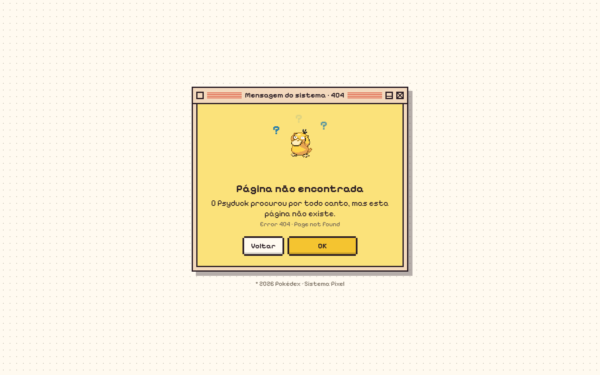 |

| Celular: Pokédex | Celular: cidade à noite |
| --- | --- |
| 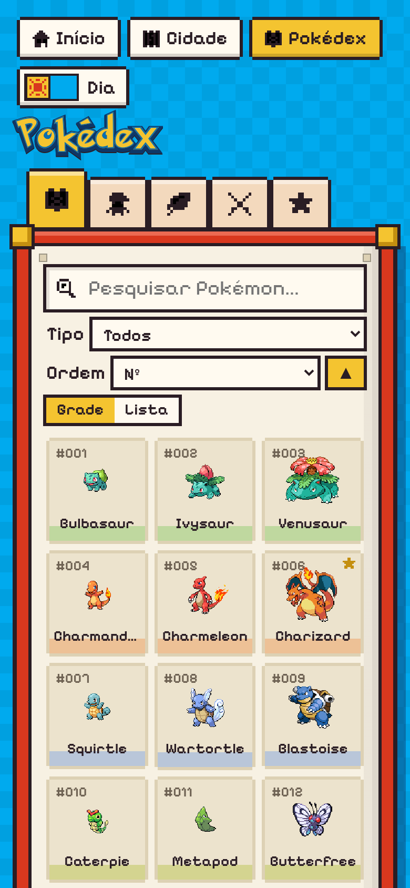 | 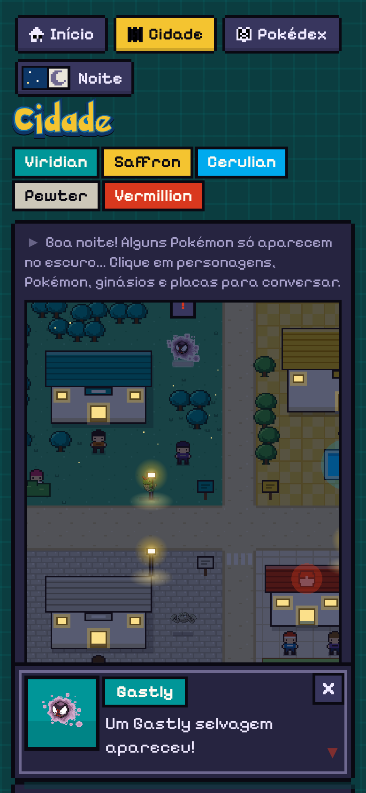 |

## 🎨 Identidade visual

**Paleta** — cinco cores com nomes de cidades de Kanto, usadas em toda a interface e nos bairros da cidade:

| Cor | Hex | Onde aparece |
| --- | --- | --- |
| Viridian | `#009698` | Fundo da cidade, bosque, fita "Cidade" |
| Pewter | `#CCC7B9` | Ruas de pedra, páginas e caixas |
| Cerulian | `#00AAEE` | Fundo da Pokédex, lago, contorno do logo |
| Vermillion | `#D9381E` | Capa do livro, porto, alertas |
| Saffron | `#F4C430` | Logo, botões principais, seleção |

**Fontes**

- **Pokemon Solid** + **Pokemon Hollow**: usadas em camadas no logotipo e nos nomes (preenchimento amarelo Solid, contorno azul Hollow e uma sombra grossa atrás). Fontes de fã, gratuitas para uso pessoal, baixadas do [DaFont](https://www.dafont.com/pokemon.font). Ficam em `src/assets/fonts/`.
- **Pixelify Sans**: fonte pixelada e legível para todos os textos, instalada via `@fontsource` (funciona offline).

**Arte** — toda a arte de cenário é **original e feita por código**: sprites descritos como grades de caracteres (`src/art/sprites.js`) e convertidos em SVG com `shape-rendering: crispEdges`, além de prédios montados com retângulos. As animações usam `steps()` para imitar quadros de jogos antigos.

## 🗺️ Páginas

| Rota | Página |
| --- | --- |
| `/` | **Tela inicial** estilo game: céu noturno com estrelas piscando, lua, nuvens, montanhas e pinheiros em pixel art, Pikachu e Bulbasaur passeando pela trilha. **START** abre um menu controlado por setas e Enter. |
| `/cidade` | **Cidade interativa** com 5 bairros (Viridian, Saffron, Cerulian, Pewter, Vermillion) e uma praça central. Clique em líderes, treinadores, Pokémon selvagens, ginásios, Centro Pokémon, loja, fonte, navio e placas para abrir uma **caixa de diálogo de RPG** com texto letra a letra. |
| `/pokedex` | **Pokédex em formato de livro**: página esquerda com pesquisa, filtro, ordenação e a lista paginada em **Grade** (sprites) ou **Lista** (cada linha com número, nome, tipos e os seis atributos); página direita com a ficha. Abas no topo e fitas marcadoras na lateral. |
| `/pokedex/:id` | Ficha de um Pokémon (frente, costas, shiny, descrição, atributos, treinadores). |
| `/pokedex/treinadores(/:id)` | Quadro de treinadores com insígnias, time e link para encontrá-los na cidade. |
| `/pokedex/habitat(/:id)` | **Habitat**: diorama isométrico em pixel art onde o Pokémon vive e interage com você (veja abaixo). |
| `/pokedex/comparar` | Batalha de atributos entre dois Pokémon, em uma "arena" estilo jogo. |
| `/pokedex/favoritos(/:id)` | Apenas os favoritos (salvos no navegador). |
| `*` | **Páginas de erro** animadas em janelas retrô (veja abaixo). |

### Habitat interativo

Cada **tipo principal** tem um cenário isométrico próprio. Todos usam o mesmo relevo em degraus e mudam cores, decoração, "lago" e clima:

| Tipo | Habitat | Tipo | Habitat |
| --- | --- | --- | --- |
| Normal | Quintal | Psíquico | Templo psíquico (cristais e colunas) |
| Fogo | Vulcão adormecido (lava e brasas) | Inseto | Floresta densa |
| Água | Lago cristalino (bolhas) | Pedra | Montanha |
| Planta | Bosque florido (pétalas) | Fantasma | Cemitério antigo (noite) |
| Elétrico | Usina da cidade (poste com fios) | Dragão | Ruínas dracônicas |
| Gelo | Geleira (neve) | Aço | Fábrica |
| Lutador | Dojô | Voador | Ilha nas nuvens |
| Veneno | Pântano tóxico | Terra | Deserto |
| Sem tipo | Tela em branco | | |

Interações:

- **Carinho e reações**: clicar no Pokémon faz ele pular, soltar corações e falar em balões; cliques demais deixam ele tonto. Um medidor de **humor** sobe com carinho, comida e brincadeira e cai devagar com o tempo. Sem interação por um tempo, ele **dorme** (Zzz) e acorda quando você mexe nele.
- **Alimentar e brincar**: arraste a **fruta** ou a **bola** da bandeja até um bloco (ou só clique nela para soltar perto). Ele calcula o caminho (busca em largura na grade), anda até lá e come, ou chuta a bola e corre atrás algumas vezes.
- **Seguir o cursor**: clique num bloco para ele andar até lá; com "Seguir cursor" ligado, ele vai atrás do mouse. Parado, ele vira para o lado do cursor.
- Teclado: com o diorama focado, as setas movem o Pokémon e Enter faz carinho.
- Só Pokémon do tipo certo entram no líquido do habitat (ex.: só os de fogo andam na lava; no gelo todos andam).

### Modo noturno

O botão **Dia/Noite** fica na navegação (cidade e Pokédex) e no canto da tela inicial. A escolha fica salva no navegador; na primeira visita, o site segue a preferência do sistema (`prefers-color-scheme`).

- **Cidade à noite:** um véu azul-escuro cobre o mapa, as janelas de ginásios, Centro Pokémon, loja e navio acendem, os **postes de luz** brilham (com leve tremulação), aparecem vaga-lumes no bosque e no jardim, e a lua se reflete no lago. Dois Pokémon **só aparecem à noite**: um Gastly no bosque de Viridian e um Zubat nas pedras de Pewter. Centro Pokémon, loja e fonte têm falas noturnas.
- **Pokédex:** páginas e caixas escuras, capa do livro mais fechada e fundo azul-noite. A arena de comparação vira um céu estrelado.
- **Habitat:** céu com estrelas, vaga-lumes e um "Boa noite!" do Pokémon ao chegar.
- As janelas retrô (erros e avisos) continuam claras, como uma tela antiga acesa no escuro.

### Páginas de erro

- **404 – página não encontrada** (`/qualquer-coisa`): um Psyduck confuso balança a cabeça com "?" flutuando.
- **Pokémon não registrado** (`/pokedex/999`): uma criatura "bugada" de blocos piscando.
- **Treinador não encontrado** (`/pokedex/treinadores/99`): um treinador olhando para os lados.
- **A Pokédex travou!** (qualquer erro inesperado; demonstração em `/glitch`): janela tremendo com efeito de glitch.
- **Sem sinal da PokéAPI**: aviso dentro da ficha quando a API externa não responde. A Pokédex segue funcionando com os dados locais.

## ✅ Requisitos da atividade

- 🐾 Exibe os 151 Pokémon do JSON. No modo **Lista**, cada Pokémon mostra número, nome, tipos e os 6 atributos direto na tela principal; a ficha mostra tudo em detalhes.
- 🔎 Pesquisa em tempo real por **nome** (sem diferenciar maiúsculas e acentos) ou **ID** (`25`, `#025`, `025`).
- 🧬 Filtro por tipo, gerado a partir dos tipos presentes no JSON.
- 📄 Ficha detalhada com barras de atributos segmentadas e total.
- 🧑‍🚀 Área de treinadores com nome, insígnias e Pokémon relacionados (na Pokédex e na cidade).
- ⚠️ Mensagem quando nenhum Pokémon é encontrado, com botão para limpar filtros.
- 📱 Responsivo: no celular as páginas do livro ficam empilhadas e o mapa rola de lado dentro do quadro.

**Desafios opcionais:** modo noturno, favoritos, comparação, ordenação (Nº, nome, cada atributo ou total, crescente/decrescente), Pokémon aleatório (fita "Sortear" e menu inicial), dados extras da PokéAPI e navegação por teclado (`←` `→` folheiam as fichas, `Esc` fecha diálogos).

> O Mew vem sem nenhum tipo no `pokedex-data.json`. Ele é tratado como "Sem tipo" (`Typeless`), que também aparece no filtro.

## ▶️ Como executar

Pré-requisito: Node.js 20 ou superior.

```bash
npm install
npm run dev
```

Abra no navegador: **http://localhost:5173**

Build de produção:

```bash
npm run build
npm run preview
```

> As rotas usam o React Router com histórico do navegador. Ao publicar em um servidor estático, configure o redirecionamento de todas as rotas para `index.html`.

## 📁 Dados

- `src/data/pokedex-data.json`: cópia do arquivo fornecido na atividade.
- `src/data/index.js`: normaliza os dados (tipo do Mew) e cria mapas por ID.
- `src/data/world.js`: bairros, cores de cada treinador e falas.
- `src/data/cityPlaces.js`: posições de tudo que é clicável no mapa.
- `src/data/habitats.js`: relevo, cores, decoração, clima e falas dos habitats.

## 🌐 Fontes externas

- **Sprites dos Pokémon:** [PokeAPI/sprites](https://github.com/PokeAPI/sprites), `https://raw.githubusercontent.com/PokeAPI/sprites/master/sprites/pokemon/{id}.png` (mais `back/` e `shiny/`). Sem internet aparece um "?" no lugar.
- **Dados complementares:** [PokéAPI](https://pokeapi.co/), `/api/v2/pokemon/{id}` e `/api/v2/pokemon-species/{id}` (altura, peso, categoria e descrição), buscados com `useEffect` ao abrir uma ficha.
- **Fontes Pokemon Solid/Hollow:** [DaFont](https://www.dafont.com/pokemon.font).

## 🧩 Organização do projeto

```text
src/
├── art/sprites.js              # Grades de pixel art originais (pessoas, árvores, lua, nuvens...)
├── assets/fonts/               # Pokemon Solid e Pokemon Hollow
├── components/
│   ├── common/                 # Logo, RetroWindow, PixelArt, PixelIcon, Person, StatBar, TypeBadge...
│   ├── home/NightScene.jsx     # Cenário da tela inicial
│   ├── city/                   # CityMap, MapArt (prédios), DialogueBox, PlacesList
│   ├── habitat/                # Diorama, Terrain, Decor, Weather, iso.js (projeção e caminhos), items
│   └── pokedex/                # Book, PokemonGrid, PokemonList, GridControls, Pager, PokemonPage, TrainerPage, ComparePage...
├── context/                    # FavoritesContext e ThemeContext (dia/noite)
├── css/                        # Um arquivo de estilo por componente/página
├── data/                       # JSON + dados do mundo da cidade
├── hooks/                      # useLocalStorage, usePokemonExtra, useTypewriter, useArrowNavigation...
├── pages/
│   ├── HomePage.jsx
│   ├── CityPage.jsx
│   ├── ErrorPage.jsx
│   └── pokedex/                # PokedexLayout + abas (PokemonTab, TrainersTab, HabitatTab, CompareTab)
├── utils/                      # pokemon.js (busca, ordenação, cores) e pixel.js (grade → SVG)
├── App.jsx                     # Componente raiz: tema, favoritos e área das páginas (<Outlet />)
├── router.jsx                  # Rotas, loaders de validação e páginas de erro
├── main.jsx
└── index.css                   # Paleta, fontes e estilos globais
```

### Conceitos de React utilizados

Componentes funcionais, props, `useState`, `useEffect`, `useMemo`, `useCallback`, `useRef`, Context API, hooks customizados, renderização de listas com `map()`, eventos de mouse e teclado, estado derivado (lista filtrada e ordenada), renderização condicional e roteamento com React Router (rotas aninhadas, `Outlet` com contexto, loaders e `errorElement`).

## 📦 Dependências

| Pacote | Uso |
| --- | --- |
| `react`, `react-dom` | Interface |
| `react-router-dom` | Páginas e rotas |
| `vite`, `@vitejs/plugin-react` | Build e servidor de desenvolvimento |
| `@fontsource/pixelify-sans` | Fonte pixelada local |

---

Pokémon e seus nomes são marcas de Nintendo / Game Freak / The Pokémon Company. As fontes Pokemon Solid/Hollow são criações de fãs. Projeto acadêmico, sem fins comerciais.
